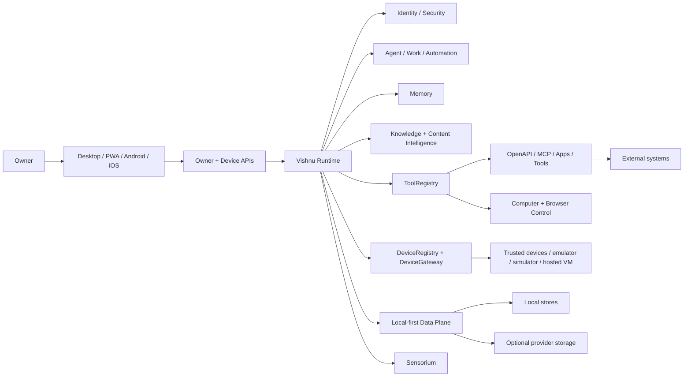
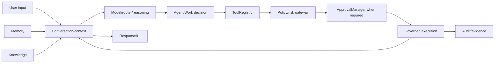
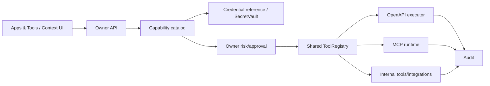
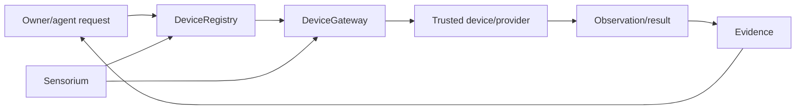
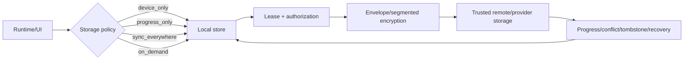
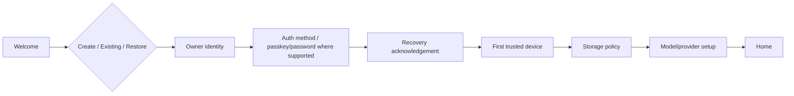
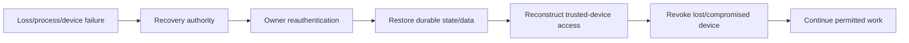

# Vishnu Current Architecture

Canonical baseline: `a8d3310b4d9090a42800621b1b27cb6045443c1e`.

This is the current engineering reference. Root `ARCHITECTURE.md`, `ARCHITECTURE_V4.md` and `ARCHITECTURE_V5.md` remain useful historical documents but do not override live code.

## System context

## Runtime flow

## Identity and security

- Owner identity is separate from device identity.
- Trusted devices are owned by the canonical `DeviceRegistry`; communication/dispatch belongs to `DeviceGateway`.
- Sessions/request context must resolve to an active trusted device with appropriate scope for owner/device APIs.
- Sensitive owner changes can require recent reauthentication.
- `ToolRegistry` is the canonical governed action boundary. Risk, permission, destination and classification rules are evaluated before execution.
- `ApprovalManager` is the durable approval authority. Approval tickets bind execution/tool/parameters/owner/device/session/security epoch and bounded use count; uncertain dispatch is fenced for recovery.
- `SecretVault`/root-key systems own secrets and credential references. APIs should not return raw credentials.
- Emergency stop/autonomy controls and security epochs are durable.
- Audit/evidence records are part of the execution contract, not optional UI telemetry.

## Action/capability architecture

Universal Capabilities lives under `integrations/discovery/*` and `server/apps_tools_api.py`. The top-level `capabilities/` directory is evaluation/benchmark code and must not be treated as the capability catalog authority.

Approved OpenAPI/MCP operations are attached to the existing ToolRegistry; restart rehydration reconstructs approved registrations while live connection rows/revocation still fence execution. Capability discovery is distinct from executable approval.

## Device and Sensorium architecture

Sensorium is a sensing/observation/world-model authority, not an action-authority bypass. Virtual simulation, Android Emulator, iOS Simulator and hosted Linux/Windows/macOS VM providers can qualify hardware-free paths. Physical-device L4 is a distinct evidence boundary.

## Data architecture

Data movement is policy-governed. The architecture does not permit silent movement merely because remote storage is available. The current provider/storage fabric adds resumability, ranges/multipart, provider health/capabilities and placement/replica metadata without changing that rule.

Canonical data domains remain separate:

- MemoryStore: personal conversational/behavioral memory.
- Knowledge: user/source knowledge and UCI ingestion/retrieval.
- DeviceRegistry: trust/device state.
- Capability/connector state: external capability metadata and credential references.
- Work/Projects/Products: durable domain state.
- Approval/execution controls: governed action state.
- Audit/evidence: security/qualification/action evidence.

Shared SQLite/versioned migrations are the production datastore foundation for migrated local stores. Sensitive data is encrypted where its domain classification requires it.

## Memory and Knowledge

Memory and Knowledge are deliberately separate authorities. Memory captures/retrieves owner interaction context; Knowledge ingests sources/files and provides grounded retrieval/citations. Architecture tests prohibit silently collapsing these domains into one store.

Universal Content Intelligence feeds Knowledge/content graphs using native parsing, OCR/visual extraction, media transcription where dependencies are available, and semantic extraction. Advanced OCR/HTR components must retain their current evidence boundaries; the repository does not justify a general foundation-model claim.

## Work/agent architecture

User intent can become a Work/agent lifecycle with planning, tool selection, approval, durable execution, cancellation, retries, evidence, completion judging and restart recovery. Projects and Work are linked but remain explicit domain concepts. Attention/notification surfaces project important state back to the owner.

Intelligence Lab and self-improvement systems are governed/gated. They do not receive a second action executor: real-world actions still flow through canonical tools/policy/approvals.

## Voice and vision

Voice and Vision are input/output/sensing capabilities integrated with conversation and Sensorium. Provider-specific systems such as OpenVoice/VoiceStudio are isolated provider boundaries. VoiceStudio MCP is projected through Universal Capabilities instead of bypassing ToolRegistry. Real carrier/provider and physical-acoustic qualification remain separate from software/loopback CI.

## Product/build architecture

The Products domain owns product manifests/runtime composition and governed build/qualification paths. Development artifacts can be produced for multiple platforms. Production signing, notarization, store acceptance and other external release credentials remain external gates and are not inferred from successful development builds.

## Product surfaces

### Desktop
Primary navigation verified in `ui/main_window.py`:

Home; Conversation; Memory; Knowledge; Activities; Dashboard; Apps & Tools; Settings.

Additional focused UI modules include first run, capability management, native auth, mobile pairing, memory detail, products and control/settings panels.

### PWA
PWA exposes conversation/context, Work/agents and progressive-disclosure owner controls. Infrastructure subsystems do not automatically receive top-level navigation; Settings/Advanced/More/contextual surfaces are valid exposure locations.

### Android/iOS
Native companions are trusted-device/product surfaces, not replacements for the canonical server/runtime authorities. Emulator/simulator qualification must not be restated as physical-device qualification.

## Authentication / first-device flow

Identity creation, trusted-device enrollment, runtime provisioning and data location are separate concepts. A browser/device enrollment must not be described as hosting a full runtime unless code actually provisions one.

## Recovery flow

## Release boundary

Current CI includes general CI plus architecture, assurance, data-plane, capability, intelligence, work, Sensorium, Voice, dependency, package/platform, release and reproducibility evidence. Exact-SHA CI is evidence for that SHA only. It is not production acceptance.

## Intentional limitations / external gates

- No production deployment is performed by this audit.
- External OAuth/provider consent and callbacks must be configured and verified separately.
- Physical-device L4, physical acoustics/camera/background behavior and store distribution require real hardware/platform evidence.
- Production signing/notarization/store credentials are owner/external inputs.
- Live telephony and paid provider behavior require approved real accounts.
- Simulator/emulator/mock/fixture evidence must remain labelled as such.
