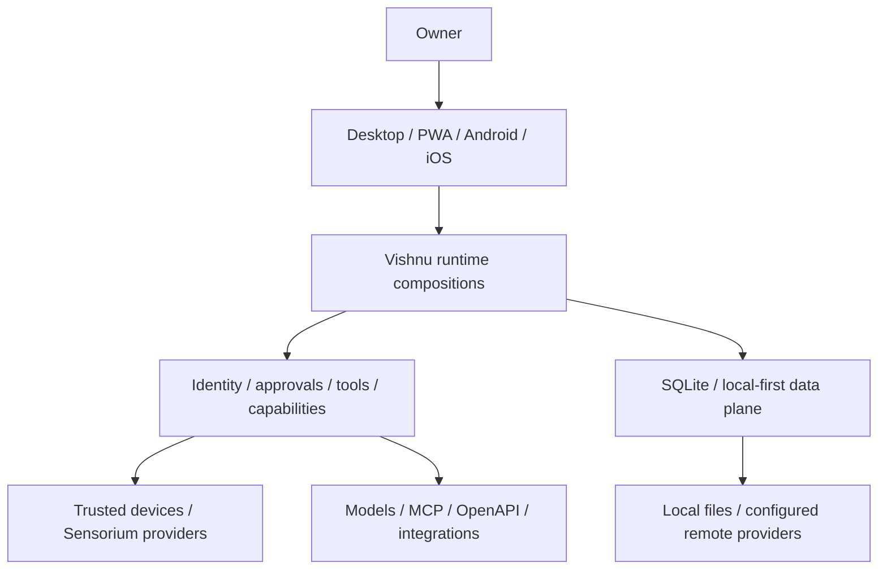
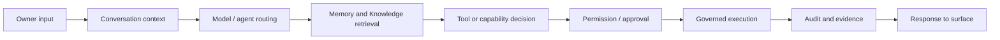
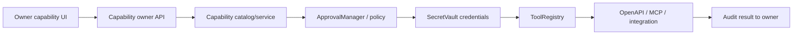
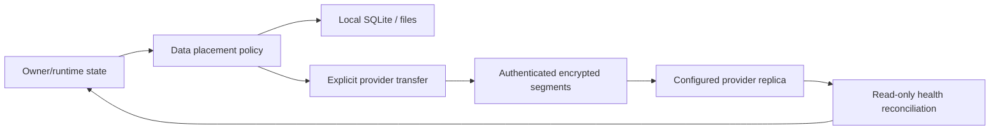
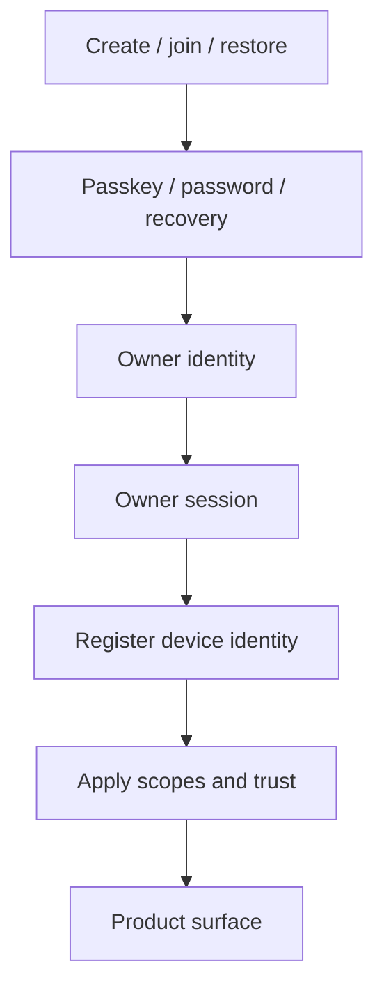
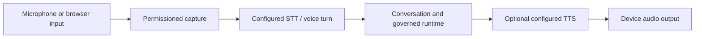
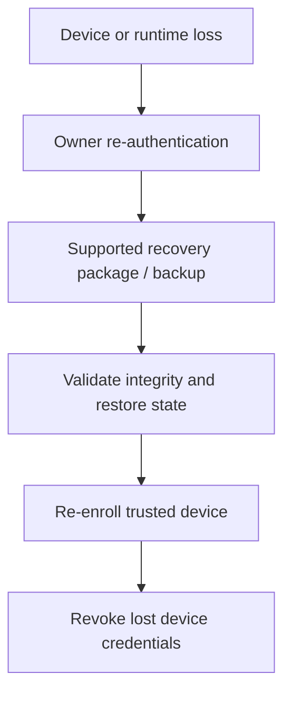

# Vishnu current architecture and execution flows

**Audited SHA:** `a8d3310b4d9090a42800621b1b27cb6045443c1e` on `main`.

## System context

The system is single-owner by design in current documentation. The repo is public, but neither its current SQLite schema nor owner-scoped APIs are evidence of general tenant isolation. There are multiple server composition roots: desktop/local API, hosted runtime, cloud/PWA. Their routers and lifecycle wiring differ and must be compared when qualifying a feature.

## Runtime request path

Conversation, model routing, context retrieval and action exposure are spread across runtime compositions and client code; this diagram is the intended source-level relationship, not proof that every feature invokes every step. OpenAPI/MCP execution is governed by capability policy, ToolRegistry, approval and audit systems where the governed execution path is selected. Do not infer that all agent/tool operations share identical coverage from this diagram.

## Capability execution

The exact implementation varies by capability kind. Capability discovery and stored descriptors do not themselves grant execution. MCP user-added endpoints and internally configured loopback endpoints have separate transport rules. VoiceStudio's internal loopback exception is narrowly scoped and startup discovery remains inert (PR #242). Credential consent and third-party provider acceptance are external qualification items.

## Device path

Device identity is distinct from owner identity. Native Android/iOS sources exist for pairing, passkeys, recovery, data-plane stores and Sensorium features, but coverage is uneven. Android Emulator, iOS Simulator and hosted VM evidence are not physical-device acceptance. Sensorium physical actions and L4 qualification are explicitly gated.

## Data path

The local-first policy labels are `device_only`, `progress_only`, `sync_everywhere`, and `on_demand`. PR #245 adds a resumable provider transfer/storage fabric foundation, capability/health tracking, S3-compatible multipart/range paths, encryption reuse, placement planning and non-destructive reconciliation. The implementation does not silently move owner data or automatically repair cloud replicas. Live provider configuration, owner consent, and real transfer acceptance remain unverified.

## Authentication and enrollment

Owner identity is not the first device ID. The repository has server and native client code for creation, login, passkey, recovery, provisioning, and enrollment. A complete cross-platform flow depends on runtime provisioning and external hosting, and was not executed in a fresh device environment for this audit.

## Voice path

The current source separates Voice Intelligence policy from optional provider runtime and Voice Lab. The existing `VoicePlan` is adapted to model-agnostic synthesis; a provider runtime is disabled by default unless explicitly enabled and composed. Voice Lab and governed telephony are isolated, default-off research/qualification features. Real STT/TTS provider and physical-acoustics behavior are `NOT VERIFIED` here.

## Recovery path

Crash, database, vault rotation, portable backup/restore, continuity and durable-work recovery have dedicated code and tests. Those tests establish fixture behavior, not the existence of an up-to-date owner production backup or a successful production restore. Production recovery is therefore `BLOCKED / NOT VERIFIED` until an isolated restore is accepted from the actual intended data root.

## Runtime, data and release boundaries

- `Memory` and `Knowledge` remain distinct domains.
- `ToolRegistry`, `ApprovalManager`, `DeviceRegistry`, `DeviceGateway`, `SecretVault`/`RootKeyStore`, and audit are canonical authorities; integrations should adapt to them.
- `future_intelligence`, `intelligence_lab`, evolution/training and qualification surfaces are gated or experimental; their presence is not general autonomous authority.
- `render.yaml` currently describes a headless Render runtime and persistent disk with auto-deploy off. Older readiness records refer to a Railway deployment observed on 2026-10-15. Current live hosting, runtime SHA, health, volume contents, and backup state were not checked.
- No production deployment, migration, secret rotation, provider connection or live data operation was performed.
