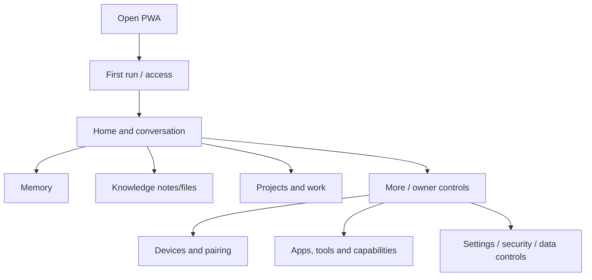
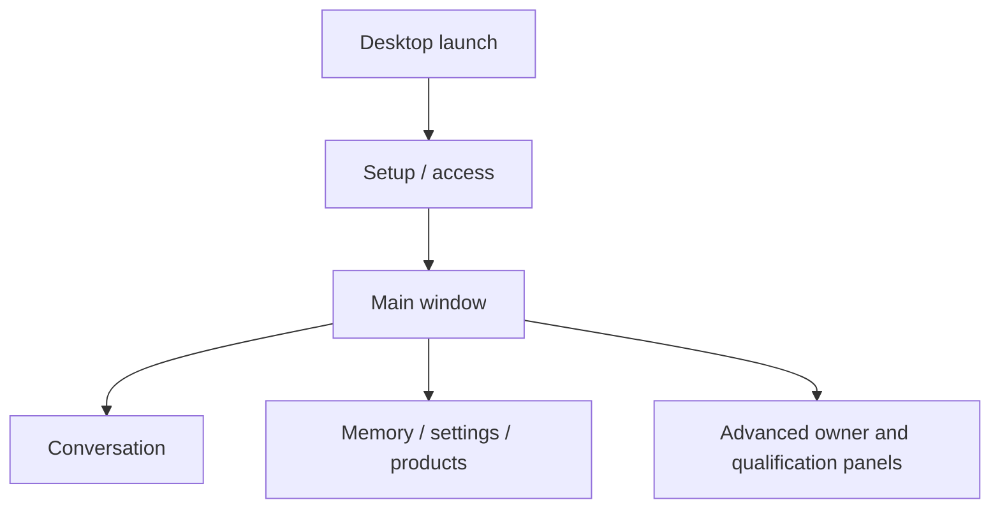
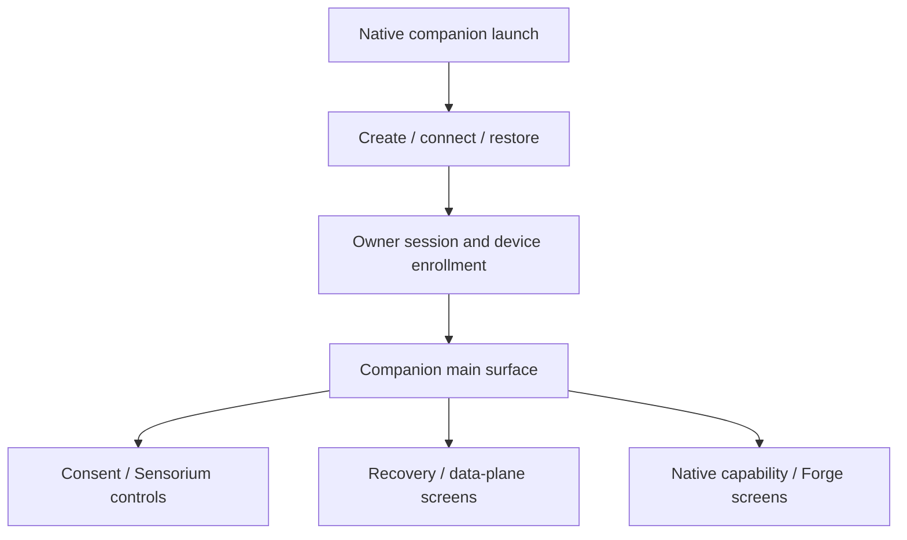

# Navigation and reachability map

**Baseline SHA:** `a8d3310b4d9090a42800621b1b27cb6045443c1e`.

## PWA / web owner product

The actual DOM and JS navigation is spread across `pwa/index.html`, `pwa/first-run.js`, `pwa/home-chat-redesign.js`, `pwa/reference-pages.js`, domain scripts and `server/cloud_app.py`. The flow above is a domain-level map. Every control and route has not been individually clicked in a browser during this audit; route reachability is not inferred from source file presence.

## Desktop

Desktop surface is under `desktop/` and bootstrapped through `app/main.py`. Exact menu reachability and backend wiring for every panel remain `NOT VERIFIED` by a live GUI session.

## Android and iOS

Native flows are distinct implementations in `android-companion/` and `ios-companion/`; a server feature or PWA route is not mobile parity. Instrumentation and simulator workflows exist. Physical devices and native signing remain external qualification.

## Reachability classifications

Use `DIRECT`, `SETTINGS`, `ADVANCED`, `FEATURE_FLAGGED`, `DEEP_LINK`, `DEVELOPER/QUALIFICATION`, `INTERNAL`, `ORPHAN`, and `NOT VERIFIED`. Current available evidence supports classifying the Voice Lab and Intelligence Lab primarily as owner/admin/research/qualification surfaces, Sensorium APIs as owner/internal/agent infrastructure with selected native screens, and general core PWA navigation as user-facing. A comprehensive orphan screen census requires runtime navigation instrumentation; source-only inventories are not enough.
