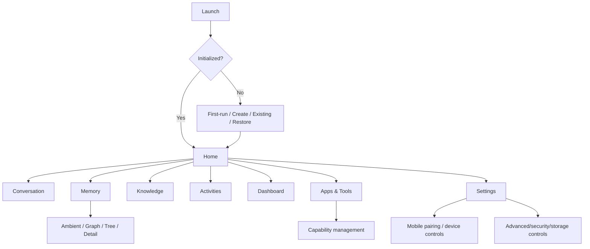
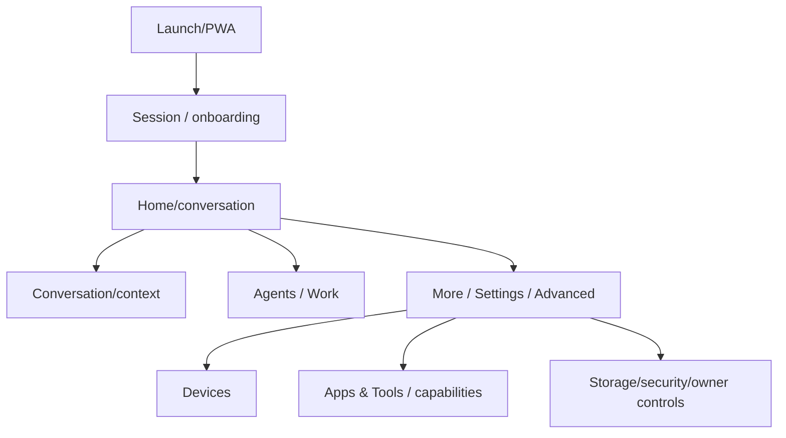
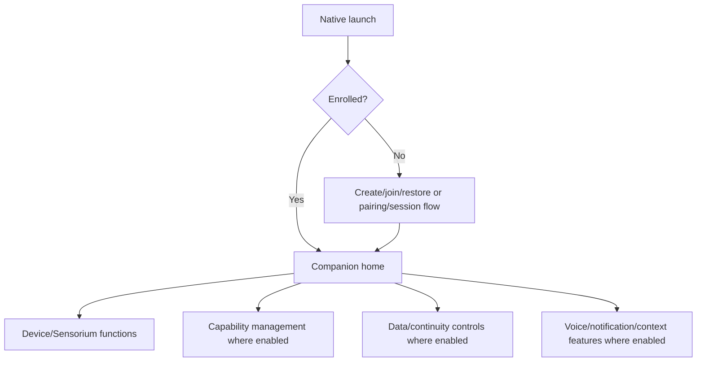

# Navigation Map

Baseline: `a8d3310b4d9090a42800621b1b27cb6045443c1e`.

## Desktop

The eight primary destinations are directly instantiated/wired in `ui/main_window.py`. Focused dialogs/panels are contextual/settings/progressive disclosure rather than automatically new top-level routes.

## PWA/Web

Exact DOM route/link reachability for every PWA component is `NOT VERIFIED` until generated from current assets/runtime wiring. Progressive disclosure is treated as valid architecture when intentional.

## Android / iOS

Emulator/simulator reachability does not establish physical-device behavior.

## Reachability risks to keep visible

- Source files are not counted as screens unless instantiated/linked.
- Deep links require handlers and authentication/scopes.
- Advanced/qualification surfaces may be intentionally hidden from ordinary users.
- Internal registries, crypto, migrations, queues and conflict resolvers do not need direct screens.
- Exhaustive orphan-page/dialog detection remains `NOT VERIFIED` pending automated route/control inventory.
