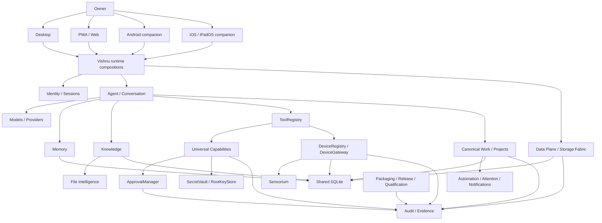

# Vishnu System Connections

**Audited main:** `5e2b88bff46bca2d4d212731ddad37fe59a7e88a`

This document shows the canonical relationship among major systems. Arrows describe intended/current source-level composition; they do not imply every edge has been accepted on every platform.

## Whole-system graph



## Conversation flow

```text
Owner
→ Desktop/PWA/native conversation surface
→ owner session / device-scope checks
→ conversation context
→ model/agent routing
→ Memory retrieval + Knowledge retrieval where applicable
→ response generation
→ optional governed tool/capability decision
→ approval/security gate when required
→ execution
→ audit/evidence
→ persisted/displayed response
```

**Key boundaries:**
- live provider behavior depends on configured provider consent/credentials;
- Memory and Knowledge are separate retrieval domains;
- a tool decision does not bypass approval/risk policy;
- not every conversation requires every stage.

## Memory

```text
Owner
→ Memory UI
→ Memory owner/governance API
→ Memory runtime/store
→ shared SQLite/migrations
→ retrieval into conversation context
→ owner detail/search/governance view
```

Security layers include owner/session scope, domain governance and at-rest protections where implemented. Full cross-surface lifecycle acceptance remains PARTIAL.

## Knowledge and files

```text
Owner
→ Knowledge UI / attachment / Add Source
→ content-ingestion API
→ File Intelligence parser/extractor
→ Knowledge domain/store
→ shared SQLite / indexed representation
→ retrieval with source/citation metadata
→ conversation or Knowledge detail UI
```

Parser/model support is configuration-dependent. Optional OCR/model libraries are not a universal format guarantee.

## Capabilities: OpenAPI / MCP / integrations

```text
Owner
→ Apps & Tools / Capabilities UI
→ capability owner API
→ capability catalog/service
→ risk/policy classification
→ ApprovalManager (for governed operations)
→ SecretVault credential access
→ ToolRegistry projection
→ OpenAPI / MCP / integration target
→ bounded result
→ audit/evidence
→ owner result/status
```

Discovery/stored descriptors do not grant execution by themselves. One-use approvals and risk floors are part of the canonical security path. REA and VoiceStudio are integrations into this system, not alternate execution authorities.

## Devices

```text
Owner
→ Devices UI / native Connect
→ identity/session
→ DeviceRegistry
→ trust/scopes
→ DeviceGateway
→ trusted device / emulator / simulator / provider
→ allowed command/sensor request
→ result/evidence
```

Owner identity and device identity are separate. Physical devices remain a different qualification tier from emulator/simulator/VM evidence.

## Sensorium

```text
Owner consent/privacy controls
→ Sensorium permissions/privacy zones
→ DeviceGateway / provider
→ permissioned sensor/context observation
→ world/context state
→ agent/context use OR qualification evidence
→ audit/evidence
```

Advanced causal/procedural/world-model layers do not independently grant physical action authority.

## Data Plane / Storage Fabric

```text
Owner data/state
→ data classification / policy
→ device_only | progress_only | sync_everywhere | on_demand
→ local SQLite/files
→ explicit governed transfer plan when remote placement is allowed
→ authenticated encrypted transfer segments
→ configured provider
→ provider health/location metadata
→ non-destructive reconciliation
```

Important rule: policy/placement planning does **not** authorize silent movement of existing owner data. Live provider acceptance remains external.

## Recovery

```text
Loss / new device
→ owner reauthentication
→ recovery code/package/backup verification
→ restore supported state
→ create/re-enroll trusted device
→ revoke lost device credentials if needed
→ resume product
```

Synthetic/unit DR evidence is not equivalent to an accepted restore from the actual production data root.

## Canonical Work / Projects

```text
Owner goal/project
→ Project / Today / Live Work UI
→ GoalSpec / WorkPlan
→ WorkOrder
→ specialist/tool/capability execution
→ approvals as required
→ attempts/effects/evidence/claims
→ Completion Judge / review
→ Attention/Notifications/Activity projection
→ final result / recovery / continuation
```

This is the canonical durable-work truth path. Avoid a parallel task model that bypasses WorkOrder/evidence/approval authorities.

## Automation

```text
Owner automation/workflow
→ workflow definition
→ authorization / configuration gate
→ scheduled/event/manual trigger
→ governed work/tool execution
→ approval where required
→ durable state / recovery
→ Activity + Attention + Notification
```

Background delivery still depends on the actual runtime being deployed/running and correctly configured.

## Voice

```text
Microphone / browser/native input
→ explicit capture permission
→ configured STT / voice turn
→ conversation runtime
→ model/agent/tool governance
→ VoicePlan / Voice Intelligence
→ optional configured TTS/provider/conversion
→ device audio output
```

Voice Lab and telephony are isolated/default-off advanced paths; OpenVoice/VoiceStudio/provider availability are not assumed from source presence.

## Products / build / release

```text
Owner product definition
→ Product Composer
→ deterministic artifact/build runner
→ platform-specific package target
→ qualification/evidence
→ license/distribution/signing gates
→ governed release authority
→ preview/smoke/canary where configured
→ production acceptance / rollback
```

Build-target support is not public distribution acceptance. Mobile/desktop signing, notarization/store agreements and actual deployment are external gates.

## Qualification/evidence

```text
Candidate SHA
→ CI / reliability / security / package / platform workflows
→ emulator/simulator/browser/VM evidence
→ evidence artifacts
→ governed release decision
```

Evidence is always scoped to its SHA and environment. Historical green checks do not automatically qualify a later SHA.

## UI reachability model

### Desktop
`CanonicalMainWindow` → Home / Conversation / Memory / Knowledge / Activities / Dashboard / Apps & Tools / Our Products / Settings.

### PWA
Home → conversation/history; Memory; Knowledge; Today; Inbox; Live Work; Projects; Activity; Apps & Tools/Capabilities; Automations; Devices; Settings/Security/Data/Recovery/Providers/System/About.

### Android/iOS
Native companion → create/connect/restore + trust/passkey/provisioning + OS-bound capability/Sensorium/recovery functions → trusted PWA for broad owner workspace.

## Canonical authority constraints

These dependencies are architecture invariants:

1. Memory does not become Knowledge and Knowledge does not become Memory.
2. Universal Capabilities use ToolRegistry, ApprovalManager and SecretVault rather than replacing them.
3. Sensorium/device operations use DeviceRegistry/DeviceGateway and permission/trust boundaries.
4. Data providers obey Data Plane policy; they do not silently decide placement.
5. Agents/automations use canonical durable Work where long-running governed work is required.
6. Release/deployment code does not bypass qualification/evidence/owner authority.
7. Experimental Intelligence/Voice/Sensorium/Forge layers do not automatically become production authority.