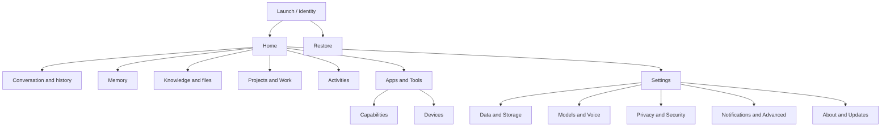

# Vishnu UI Truth Map

**Exact audited main SHA:** `4ec735de327f2bab6dccb774e2a9c28ef4fc44af`  
**Repository:** `vaishnavsawant1994-stack/vishnu`  
**No production deployment performed.**

## Executive summary

This audit defines **30 canonical logical owner-facing screens** from the implemented product surface and required owner controls. 29 have a source-backed implementation or partial surface; 1 is classified missing. **0 are called complete** because this campaign did not execute every screen’s live API mutations, persisted reload, security gate, failure state, accessibility behavior, and visual evidence as one qualified path. That is an evidence threshold, not a claim that all surfaces are broken.

A screen count is a product taxonomy, not a count of files, tabs or native view structs. Settings subsections and view/detail steps remain grouped unless they represent a distinct owner task. Existing internal test consoles are not counted as consumer screens. Today (`reference-pages.js`) and Visualize (`visualize-workspace.js`) are included as distinct reachable logical destinations.

## Count definitions and totals

| Measure | Count | Basis |
|---|---:|---|
| Canonical required screens | 30 | Logical owner-facing destinations in `ui_truth.json` |
| Present or partial | 29 | Source has a corresponding surface; not a completion claim |
| Complete | 0 | Full behavior + accessibility + visual proof not demonstrated |
| Partial | 29 | Source-backed surface with one or more unverified/incomplete links |
| Missing | 1 | Required capability has no verified active product destination |
| Orphaned / disconnected | 0 / 0 | No source-proven canonical orphan/disconnect in this pass; disabled/preview controls remain partial |
| Platform classification cells | 120 | 4 platform values for each logical screen; includes N/A and not verified |
| Platform surface implementations present/partial/blocked | 90 | Cells with source-backed surface state; not a completed parity count |
| Platform cells N/A / missing / not verified | 17 / 1 / 12 | Explicit platform coverage labels |
| Secondary surfaces source-catalogued | 11 | 5 PWA `<dialog>` IDs, 4 named PWA drawers/screen overlays, 2 iOS sheet flows; native OS prompts/dynamic overlays not exhaustive |
| Major visual state classes | 14 | loading, empty, populated, editing, saving, success, error, offline, unauthorized, approval, disabled, revoked, expired, degraded |
| Full canonical screens visually verified | 0 | Companion subviews are not equivalent to their full PWA/desktop/native canonical screen flows |
| Companion views screenshot-captured and manually inspected | 4 | Home, Memory, Control (pairing/emergency), Dashboard in CI artifacts; 8 post-change screenshots at phone/tablet/desktop/wide sizes |
| Canonical screens not fully visually verified | 30 | Companion views do not prove every canonical platform implementation or state |
### By domain

| Domain | Required logical screens |
| Labs | 1 |
|---|---:|
| AI | 1 |
| Activity | 1 |
| Advanced | 1 |
| Capabilities | 1 |
| Conversation | 2 |
| Core | 2 |
| Data | 1 |
| Devices | 2 |
| Identity | 2 |
| Integrations | 1 |
| Knowledge | 1 |
| Memory | 1 |
| Notifications | 1 |
| Onboarding | 1 |
| Privacy | 1 |
| Projects | 1 |
| Recovery | 1 |
| Security | 1 |
| Settings | 1 |
| System | 4 |
| Voice | 1 |
| Work | 1 |

## Information architecture

The active PWA `openModule` registry has Home, Memory, Knowledge, Activities, Workflows, Apps & Tools, Devices, Dashboard, Settings, Owner and System; separate reachability layers add Today, Projects, Visualize, and conversation/history views. Desktop `MainWindow.NAV` exposes Home, Conversation, Memory, Knowledge, Activities, Dashboard, Apps & Tools and Settings. Android/iOS are companion control surfaces with connect, recovery, security, voice/Sensorium and capability screens; their source does not establish a full parity UI.

## Master screen matrix

| ID | Screen | Required | Exists | Reachable | Connected | Desktop | PWA/Web | Android | iOS | Visual | A11Y | Status |
|---|---|---|---|---|---|---|---|---|---|---|---|---|
| ONB-001 | Connect / first run | Yes | Yes | Yes | Partial | Not verified | Partial | Partial | Partial | Not verified | Not verified | partial |
| AUTH-001 | Sign-in and session recovery | Yes | Yes | Yes | Partial | Not verified | Partial | Partial | Partial | Not verified | Not verified | partial |
| REC-001 | Restore Vishnu | Yes | Yes | Yes | Partial | Not verified | Partial | Partial | Partial | Not verified | Not verified | partial |
| HOME-001 | Home | Yes | Yes | Yes | Partial | Partial | Partial | N/A | N/A | Not verified | Not verified | partial |
| CHAT-001 | Conversation | Yes | Yes | Yes | Partial | Partial | Partial | Partial | Partial | Not verified | Not verified | partial |
| CHAT-002 | Conversation history and search | Yes | Yes | Yes | Partial | Partial | Partial | Partial | Not verified | Not verified | Not verified | partial |
| MEM-001 | Memory | Yes | Yes | Partial | Partial | Partial | Partial | N/A | N/A | Not verified | Not verified | partial |
| KNW-001 | Knowledge and files | Yes | Yes | Yes | Partial | Partial | Partial | Partial | Partial | Not verified | Not verified | partial |
| ACT-001 | Activities | Yes | Yes | Partial | Partial | Partial | Partial | Not verified | Not verified | Not verified | Not verified | partial |
| WRK-001 | Workflows and active work | Yes | Yes | Yes | Partial | Partial | Partial | Partial | Partial | Not verified | Not verified | partial |
| PRJ-001 | Projects | Yes | Yes | Partial | Partial | Partial | Partial | Partial | Not verified | Not verified | Not verified | partial |
| APP-001 | Apps & Tools | Yes | Yes | Yes | Partial | Partial | Partial | Partial | Partial | Not verified | Not verified | partial |
| CAP-001 | Capability management | Yes | Yes | Yes | Partial | Partial | Partial | Partial | Blocked | Not verified | Not verified | partial |
| DEV-001 | Trusted devices | Yes | Yes | Partial | Partial | Partial | Partial | Partial | Partial | Not verified | Not verified | partial |
| DAT-001 | Data & Storage | Yes | Yes | Partial | Partial | Partial | Partial | Partial | Partial | Not verified | Not verified | partial |
| MOD-001 | Models & AI providers | Yes | Yes | Partial | Partial | Partial | Partial | N/A | Partial | Not verified | Not verified | partial |
| VOC-001 | Voice | Yes | Yes | Partial | Partial | Partial | Partial | Partial | Partial | Not verified | Not verified | partial |
| SEC-001 | Security & approvals | Yes | Yes | Partial | Partial | Partial | Partial | Partial | Partial | Not verified | Not verified | partial |
| PRI-001 | Privacy & data controls | Yes | Yes | Partial | Partial | Partial | Partial | Partial | Partial | Not verified | Not verified | partial |
| NOT-001 | Notifications | Yes | Yes | Partial | Partial | Partial | Partial | Partial | Partial | Not verified | Not verified | partial |
| SYS-001 | Dashboard | Yes | Yes | Yes | Partial | Partial | Partial | Not verified | Not verified | Not verified | Not verified | partial |
| SYS-002 | System status | Yes | Yes | Yes | Partial | Partial | Partial | N/A | N/A | Not verified | Not verified | partial |
| SET-001 | Settings | Yes | Yes | Partial | Partial | Partial | Partial | Partial | Partial | Not verified | Not verified | partial |
| OWN-001 | Owner profile and account | Yes | Yes | Yes | Partial | Partial | Partial | Partial | Partial | Not verified | Not verified | partial |
| ADV-001 | Advanced diagnostics | Yes | Yes | Partial | Partial | Partial | Partial | N/A | N/A | Not verified | Not verified | partial |
| SEN-001 | Sensorium permissions | Yes | Yes | Yes | Partial | N/A | N/A | Partial | Partial | Not verified | Not verified | partial |
| UPD-001 | About and updates | Yes | No | No | Partial | Partial | Missing | Partial | Partial | Not verified | Not verified | missing |
| TOD-001 | Today | Yes | Yes | Yes | Partial | Not verified | Partial | N/A | N/A | Not verified | Not verified | partial |
| VIZ-001 | Visualize | Yes | Yes | Yes | Partial | Not verified | Partial | N/A | N/A | Not verified | Not verified | partial |
| LAB-001 | Labs & Workspaces | Yes | Yes | Yes | Partial | Not verified | Partial | N/A | N/A | Not verified | Not verified | partial |

## Missing, orphaned, disconnected and placeholder surfaces

### Missing

**UPD-001 About and Updates** is a missing verified product destination. Update/package code exists, but no active owner navigation route is established by the scanned PWA module registry. Recommended home: Settings → About & Updates, with update controls shown only where the installed updater can verify, recover and persist. Priority P2.

### Orphaned and disconnected

No screen is labeled orphaned solely from its filename. Static evidence found no proven orphaned canonical destination. The PWA privacy renderer explicitly disables several controls and states that account deletion/project-context services are absent in that installation; these controls are classified PARTIAL, with unavailable-state copy, not as working toggles. Native iOS source explicitly says cloud access and Forge cloud controls are disabled in its internal-testing build; classify that path BLOCKED for cloud execution, not a connected feature.

### Backend without owner UI

- Update/package status: backend/package capabilities exist; an owner-facing status route is not verified (UPD-001).
- Data Plane: a connected PWA Data & Storage page now reads aggregate status/provider readiness and writes the new-data default policy through the canonical owner API; object-level movement and native parity remain unverified (DAT-001).
- Owner audit/approval history: approval panels and activity sources exist, but a comprehensive searchable security history is not verified (SEC-001 / ACT-001).
- Cross-platform trusted-device approval/revoke: registry APIs exist; full owner workflows across each client are not verified (DEV-001).
- Sensorium provider diagnostics/evidence: keep low-level provider internals in Advanced; only device-specific consent/session control is required (SEN-001).

### UI without complete backend behavior

- Privacy settings show disabled controls and explicit unavailable service statements; controls must stay disabled until connected (PRI-001).
- PWA sections support preview/demo state in code; verify preview state never appears as production success.
- iOS native app labels cloud access and capability Forge cloud controls as disabled in internal-testing build (CAP-001).
- Settings and system status contain features whose real-provider/configuration-dependent behavior requires execution evidence.

## Reachability and click paths

- Start a conversation: Launch → authenticated Home → composer → Send.
- Review prior work: Home → history/sidebar or timeline → select conversation/activity.
- Review a memory: Home/More → Memory → ambient/tree/graph view → record detail.
- Add a document: Home attachment or More → Knowledge → Upload → processing/result.
- Connect an integration: Apps & Tools → capability/import → inspect operations → credential/approval → connected.
- Revoke a device: More/Settings → Devices → device detail → revoke → confirm. Reachable path is source-supported in PWA; end-to-end revocation is not verified.
- Change the default policy for newly governed data: Settings → Data & Storage. PWA API persistence is covered by owner API tests; existing data movement is explicitly outside this control.
- Restore: signed-out access → Restore; native recovery surfaces are directly linked on Android/iOS; desktop/web parity is not verified.

## Design system, accessibility, responsive and visual evidence

The repository’s `docs/ui/DESIGN_SYSTEM.md` documents semantic tokens and CI responsive suites. It reports Playwright widths from narrow phone through wide desktop for PWA/web companion and notes desktop visual capture, physical mobile hardware, authenticated owner sessions, physical microphone, browser chrome zoom, and platform accessibility sweeps remain unverified. The PR exact-head responsive workflow captured screenshot artifacts (run [38940576760](https://github.com/vaishnavsawant1994-stack/vishnu/actions/runs/38940576760), artifact `personal-ai-design-system-web-companion`) and four companion views were manually inspected. This does not qualify the corresponding full canonical screens, so their full-screen visual status stays NOT VERIFIED; A11Y is also not fully verified.

Prior design-system CI evidence is evidence of tested responsive scenarios for the named suites, not proof that all 30 screens or all controls are correct.`

## Engineering priorities

1. **P0:** execute security, recovery, device revoke, data deletion and approval paths in isolated test environments; fix any false success or unauthorized action. No code-level P0 defect is claimed without execution evidence.
2. **P1:** qualify Home, Conversation, Memory, Knowledge, Apps & Tools, Devices and Data & Storage end-to-end, including reload/error/offline states.
3. **P2:** add the About/Updates destination only where a real updater is available; complete platform parity and screen-level visual evidence.
4. **P3:** improve diagnostics discoverability, visual consistency and assistive-technology coverage based on test results.

## Fix completed from visual evidence

The initial Control phone screenshot showed the fixed Ask composer covering part of secure browser pairing and crowding the emergency-control footer. The companion now moves the composer into document flow on non-Home management pages, and the responsive test asserts that the pairing action stays above it. The updated Control phone screenshot is in artifact run 38940576760. This fixes the observed overlap; it does not certify all companion actions or other canonical screens.

## Detailed pages and acceptance criteria

See [`PAGE_SPECIFICATIONS.md`](PAGE_SPECIFICATIONS.md) for the per-screen purpose, contents, actions, data, backend, navigation, states, responsive behavior, accessibility, evidence, gaps and acceptance criteria. See [`VISUAL_PAGE_CATALOG.md`](VISUAL_PAGE_CATALOG.md) for the visual index. Machine-readable records live in [`ui_truth.json`](ui_truth.json).

## Confidence and limits

This is an evidence-backed source/navigation blueprint at the recorded SHA. It resolves the canonical logical screen count under the stated counting rule, but it does not establish full UI completeness: there are no new screenshots, no exhaustive per-control click-through, and no fresh desktop/Android/iOS visual qualification. All such areas remain NOT VERIFIED rather than assumed.
